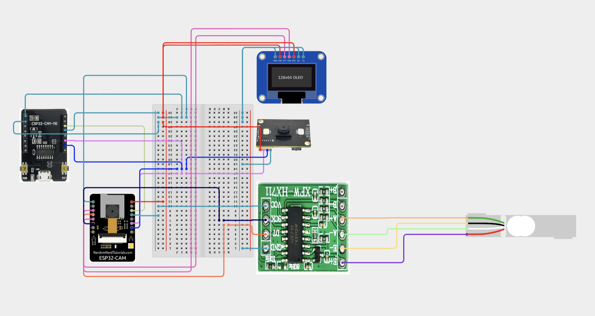
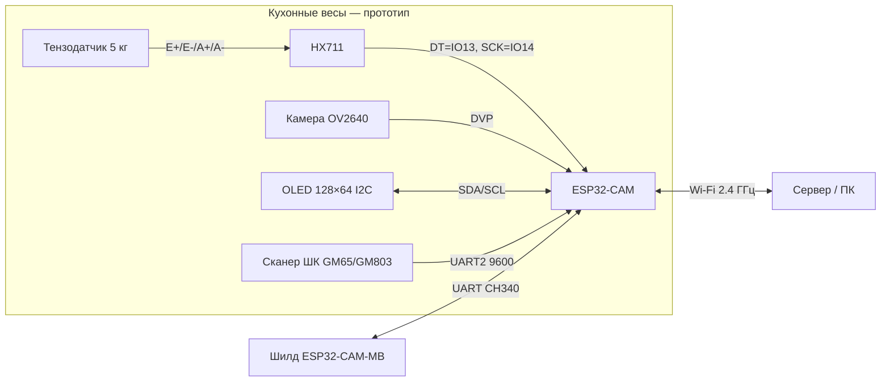
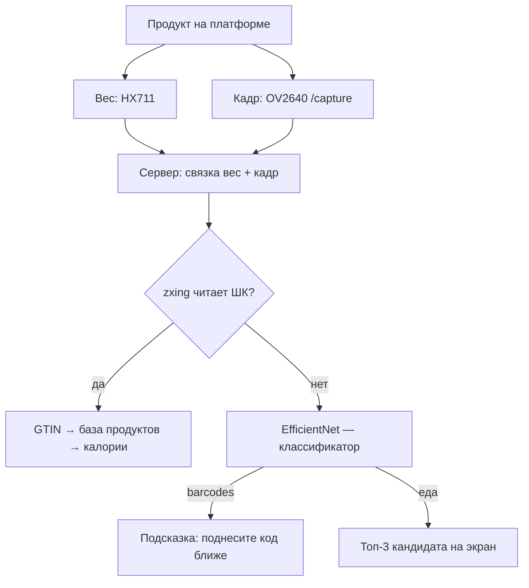
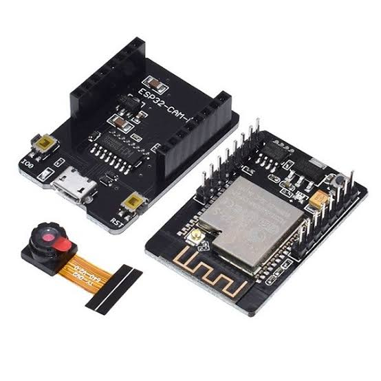
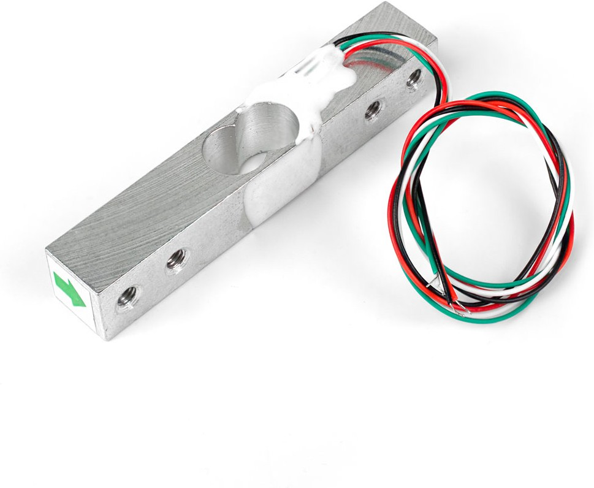

# Весы с распознаванием еды

Умные кухонные весы с камерой для автоматического учёта калорий: продукт кладут на
платформу — камера распознаёт еду (или штрихкод), вес и продукт логируются **без ручного ввода**.
Целевая розничная цена 2–3 тыс. ₽, поэтому железо максимально дешёвое, а модель распознавания
дообучается и хостится на своём сервере.

## Что уже умеет прототип

- **Взвешивать** — тензодатчик 5 кг через АЦП HX711, чтение каждые 500 мс, тара и калибровка
  сохраняются в NVS.
- **Снимать** — камера OV2640 отдаёт один кадр в UXGA (`/capture`) и MJPEG-поток (`:81/stream`),
  настройки света/цвета/размера меняются на лету (`/control`).
- **Показывать** — OLED 128×64 выводит IP, вес и последний штрихкод.
- **Читать штрихкоды** — сканер по UART2 (9600 8N1), код печатается в консоль.

## Схема

### Подключение (текущий прототип)





Основные линии (подробные таблицы пинов и история диагностики — в
[`scale_controller/CLAUDE.md`](scale_controller/CLAUDE.md)):

| Устройство | К ESP32-CAM | Примечание |
|---|---|---|
| HX711 | VCC→3V3, DT→IO13, SCK→IO14 | питание **только 3V3** (не 5V) |
| OLED 128×64 | SDA→IO12, SCL→IO15 | 7-пиновый модуль в режиме I2C (`RES`→VDD, `DC`/`CS`→GND); IO12 на этой плате повреждён — запасной вариант IO2 |
| Сканер ШК | TX→IO16 (RX UART2) | сканер только передаёт, RX сканера подтянут к 3V3 |

### Пайплайн распознавания



Штрихкод читает **не нейросеть**, а декодер zxing-cpp (точное значение либо ничего), а классификатор
решает только «еда / упаковка / какой продукт». Подробности — в
[`smart_scale/DATA_PIPELINE.md`](smart_scale/DATA_PIPELINE.md).

## Комплектующие

- **ESP32-CAM (AI Thinker)** + шилд **ESP32-CAM-MB** (USB через CH340), камера **OV2640** до 2 Мп,
  внешняя Wi-Fi антенна
  
- **Тензодатчик 5 кг** + АЦП **HX711**
  
- **OLED 0.96" 128×64** (I2C/SPI 7 pin, монохромный голубой)
- **Сканер штрихкодов** GM65/GM803-подобный (UART)
- Беспаечная макетная плата 400 точек

## Структура репозитория

```
smart_scale_workspace/
├── scale_controller/          # прошивка ESP32-CAM (PlatformIO, C++/Arduino)
│   ├── platformio.ini
│   ├── src/main.cpp           # камера + вес + OLED + сканер, HTTP-сервер
│   └── image_handler/         # Python: съёмка кадров, фокус, клиент камеры
├── smart_scale/               # ML-пайплайн (Python)
│   ├── build_dataset.py       # сборка датасета (порча кадров, labels.csv)
│   ├── ov2640_sim.py          # симуляция кадров OV2640
│   ├── prepare_esp32.py       # индексация реальных кадров ESP32-CAM
│   ├── train.py               # дообучение EfficientNet B0–B4
│   ├── export_onnx.py         # экспорт ONNX FP32 + INT8
│   ├── bench_latency.py       # замер скорости на CPU
│   └── onnx_models/           # B0–B4 (FP32/INT8, только архитектура)
└── pics/                      # фото комплектующих и схема
```

## Статус реализации

Ориентировочная готовность прототипа — **~40 %** (оценка по модулям ниже).

| Модуль | Готовность | Сделано | Осталось |
|---|---|---|---|
| Железо (сборка) | ~90 % | все компоненты подключены, вес/дисплей/сканер отвечают | пайка тензодатчика, аккуратная раскладка |
| Прошивка ESP32-CAM | ~85 % | камера + стрим, HX711, OLED, сканер, консольные команды, NVS | проверка калибровки, мелкие правки |
| Калибровка весов | ~30 % | команды `t`/`c<г>` реализованы, коэффициент хранится в NVS | калибровка по эталону, стабильность нуля |
| Датасет | ~20 % | инструменты готовы (build_dataset / ov2640_sim / prepare_esp32) | собрать фото: пока ~3 яблока + штрихкоды |
| Модель (обучение) | ~15 % | train.py и export_onnx.py готовы, ONNX B0–B4 экспортированы | запустить обучение (`runs/` пуст) |
| Сервер + интеграция | 0 % | — | связка «вес + кадр → класс», база продуктов |

Чек-лист (актуальное состояние — в разделе «Статус» файла [`scale_controller/CLAUDE.md`](scale_controller/CLAUDE.md)):

- [x] Плата выбрана, `platformio.ini`, `main.cpp` и Python-клиент написаны
- [x] Прошивка собирается (`pio run` — SUCCESS)
- [x] HX711 и тензодатчик подключены (DT=13, SCK=14)
- [x] OLED (I2C) и сканер ШК (UART2) добавлены
- [ ] Калибровка весов по эталону (`c<граммы>`), проверка стабильности нуля
- [ ] Обучение классификатора на собранном датасете
- [ ] Сервер: связка «вес + кадр → классификация»
- [ ] Сборка финального корпуса и пользовательского приложения

## Подробная документация

- [`scale_controller/CLAUDE.md`](scale_controller/CLAUDE.md) — железо, пин-ауты, процедура прошивки,
  известные проблемы и их решения
- [`smart_scale/DATA_PIPELINE.md`](smart_scale/DATA_PIPELINE.md) — как устроен датасет и как с ним работать
- [`scale_controller/shoot_instruction.md`](scale_controller/shoot_instruction.md) — съёмка датасета с ESP32-CAM
